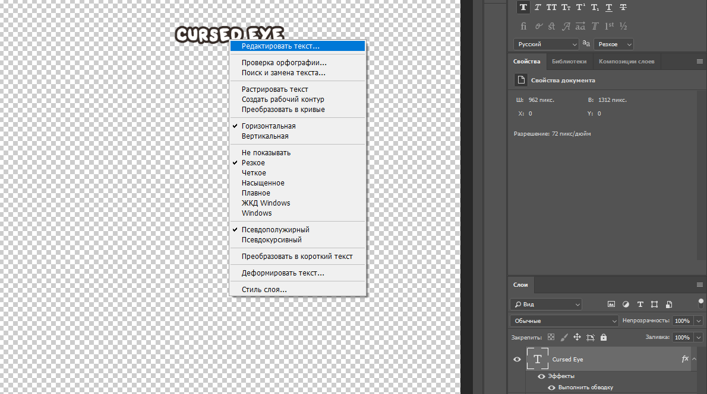
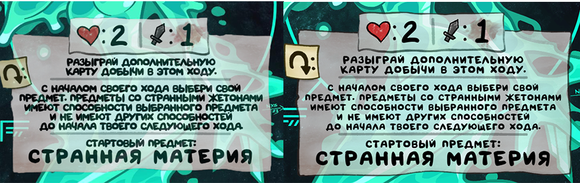

## В этом документе будут перечислены все основные требования и рекомендации к переводу и локализации карт Four Souls.

### Undertitle

Или же оригинальное название на английском над локализированным названием должно быть у каждой карты.
Готовый шаблон в [templates.psd](templates.psd), в нём достаточно просто менять текст, все позиционирование и другие настройки уже выставлены.
Шрифт - [Font_souls_Body-Regular_RU](../fonts/Font_souls_Body-Regular_RU.ttf).



### Описание карты

Главным требованием является один стиль текста и написания у всех карт.

Важно следить за пунктуацией, после каждого предложения должен стоять пунктуационный знак (обычно, точка).

Текст не должен быть слишком сжатым, постараюсь привести наглядный пример:



Такого эффекта помогут добиться вложенные теги `{xs:}`  и `{xl:}`.

Например, иногда обычный `{xs:текст}` делает текст слишком мелким, тогда можно попробовать использовать `{xs:{xl:текст}}`, в таком случае текст будет усреднённым по величине.
А если `{xs:}` наоборот не хватает, и длинный текст все равно не влезает, тогда в этом случае, можно попробовать использовать тройную вложенность `{xs:{xs:{xl:текст}}}`.
Энивей, описание каждой карты индивидуально и какого-то одного подхода в этом плане нет. Главное, чтобы текст в конечном итоге выглядел не пережатым или наоборот слишком расплывчатым, где буквы стоят далеко друг от друга.

В такие вложенные тэги также можно заключать и другие тэги форматирования, например `{q:}`.  `{xs:{xl:{q:текст}}}`

Так, следующий пункт - текст, заключенный `-` символами, например `- вечный -` или 
`- гаппи -`, лучше ставить пробел между текстом и знаками `-`, это я просто по личному опыту, так меньше шансов, что текст слипнется с `-`.

#### Вординг

В вординге есть несколько расхождений с переводом от кубиков.

1. "1 урон" вместо "1 урона", а 2 и более уже "урона".
2. "монстр, на которого нападают/не нападают" вместо "атакуемый/неатакуемый монстр".
3. Слово "названный", например, "положите жетон на предмет, названный **"имя_предмета"**", вместо этого лучше "положите жетон на предмет **"имя_предмета"**".
4. "в начале хода" вместо "с началом хода".
5. На некоторых картах сокровищ может быть написано "если игрок должен выбросить `{1}`", вместо такой записи лучше будет "когда игрок выбрасывает `{1}`".
6. "разряди предмет" вместо "деактивируй предмет".

### Редактирование карт

Для карт персонажей зачастую можно использовать готовый шаблон:

```
{xs:разыграй дополнительную
карту добычи в этом ходу.

{q:это можно сделать в любой ход,
в ответ на любое действие.}
---
стартовый предмет:}
```

#### Карты с прозрачностью

В том же файле [templates.psd](templates.psd) есть шаблон, пока только для карт персонажа. Просто покрутите его прозрачность и всё, можно использовать вместо встроенных шаблонов.
Чуть позже добавлю туда для других типов карт.

### Пассивные предметы

Стоит обращать внимание на задний фон описания, у некоторых пассивных предметов фон отличается, на нем изображен кубик, это тоже стоит учитывать.
